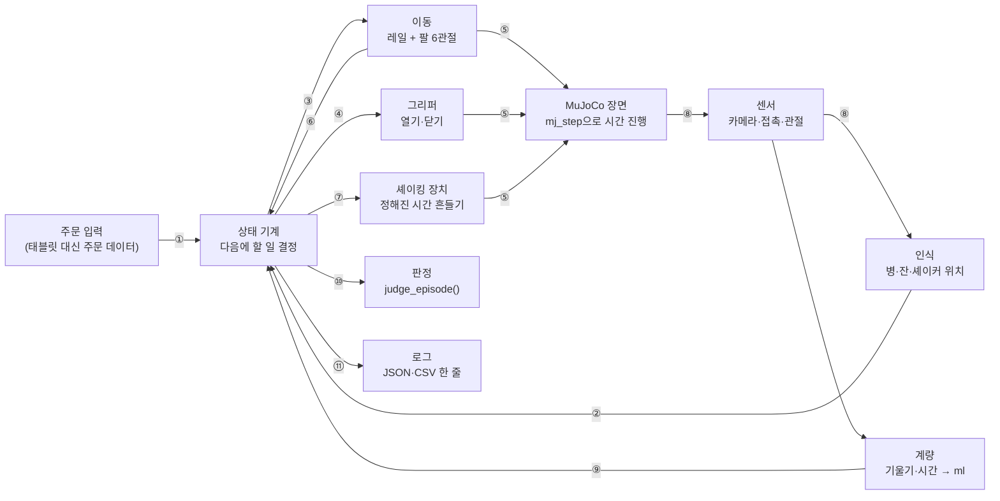

# D06 시스템 구조 · D08 안전 개념 — 칵테일 제조 로봇팔

D06 · D08 · 작성 [조준혁](시뮬레이션) · 검토 [조준혁](개발) · [조준혁](QA) · 상태 작성 · v0.1

> 로봇팔 1대(UR5e + 2F-85, 레일 위) 기준이다. 장면은 [D07 장면 구성표](scene.md), 요구사항은 [D03](requirements.md).
> 숫자는 설명용 가정값이다.

---

## 모듈과 고리

로봇 프로그램은 **감지 → 판단 → 행동 → 진행** 고리를 돈다. 칸마다 모듈 하나, 화살표마다 데이터 하나. 번호는 아래 인터페이스 표의 줄이다.

모듈 흐름: 주문 입력 → 상태 기계 → 이동(레일 · 팔) / 그리퍼 / 셰이킹 장치 → (mj_step) → 센서 → 인식 → 상태 기계 … / 계량 → 상태 기계 / 판정, 로그

| 고리 | 모듈 | 하는 일 | 파일(예정) |
|---|---|---|---|
| 감지 | 센서 · 인식 | 위 카메라(RGB · 깊이)로 병 · 잔 · 셰이커 위치를 찾는다. 손가락 접촉과 관절 위치를 읽는다 | `src/perception.py` |
| 감지 | 계량 | 병 기울기와 시간으로 부은 양을 계산한다(아래 공식) | `src/pour.py` |
| 판단 | 주문 입력 | 주문 데이터(레시피 + 맞춤)를 재료별 목표량으로 바꾼다 | `src/order.py` |
| 판단 | 상태 기계 | 다음에 할 일을 정한다(아래 상태 목록) | `src/state_machine.py` |
| 행동 | 이동 · 그리퍼 | 손끝 목표를 레일 위치 + 관절 6개 명령으로 바꾼다(역기구학). 그리퍼를 열고 닫는다 | `src/motion.py` |
| 행동 | 셰이킹 장치 | 셰이커를 정해진 시간 · 세기로 흔든다 | `src/shaker.py` |
| 진행 | MuJoCo | `mj_step`으로 시간을 한 걸음(0.002s) 진행한다 | — |
| 기록 | 판정 · 로그 | R-01\~R-03 판정, 이벤트와 결과 기록 | `src/judge.py`(있음), `src/log.py` |

---

## 인터페이스 표

| 번호 | 보내는 쪽 → 받는 쪽 | 데이터 | 형식 · 단위 | 언제 |
|---|---|---|---|---|
| ① | 주문 입력 → 상태 기계 | 재료별 목표량 | `{"레시피/재료": ml}` 예: `{"daiquiri/syrup": 7.5}` | 주문이 들어올 때 |
| ② | 인식 → 상태 기계 | 물체 목록 | `[(이름, x·y·z)]`, m | 시작 때, 놓을 때마다 |
| ③ | 상태 기계 → 이동 | 목표 손끝 자세, 레일 위치 | x·y·z m + 기울기 rad, 레일 m | 상태가 바뀔 때 |
| ④ | 상태 기계 → 그리퍼 | 열기 / 닫기 | 0(열림)\~255(닫힘) | 상태가 바뀔 때 |
| ⑤ | 이동 · 그리퍼 · 장치 → MuJoCo | 액추에이터 명령 | `data.ctrl`: 레일 m, 관절 6개 rad, 그리퍼 0\~255, 장치 m | 매 제어 주기(0.002s) |
| ⑥ | 이동 → 상태 기계 | 도착 여부, 손끝 오차 | True/False, mm | 이동이 끝날 때 |
| ⑦ | 상태 기계 → 셰이킹 장치 | 흔들기 시간 | s | 셰이커를 넣은 뒤 |
| ⑧ | MuJoCo → 센서 → 인식 | 영상, 접촉, 관절 위치 | RGB 배열, 깊이 m, True/False, rad | 매 주기 / 다시 볼 때 |
| ⑨ | 계량 → 상태 기계 | 지금까지 부은 양 | `{"레시피/재료": ml}` | 붓는 동안 매 주기 |
| ⑩ | 상태 기계 → 판정 | `targets_ml`, `poured_ml`, `dropped`, `elapsed_s` | ml, ml, 개, s | 한 판이 끝날 때 |
| ⑪ | 모든 모듈 → 로그 | 상태 · 이벤트 / 한 판 결과 | JSON 한 줄(`logs/events.jsonl`) / CSV 한 줄(`logs/results.csv`) | 이벤트마다 / 한 판이 끝날 때 |

**단위를 빼먹지 않기:** 이 프로젝트에는 **ml(밀리리터)** 와 **m(미터)**, **mm** 가 같이 나온다. 그래서 판정 함수 인자처럼 이름 끝에 단위를 붙인다(`targets_ml`, `elapsed_s`). 에이전트가 단위를 틀리면 "표대로 ml로"라고 한 줄로 다시 요청한다.

### 계량 공식(v0 가정)

MuJoCo에는 액체가 없으므로 부은 양을 계산으로 만든다(차터 플랫폼 결정).

- 병 기울기 θ가 45° 이상일 때만 따라진다.
- 1초에 따라지는 양 = 30ml × (θ − 45°) ÷ 45° (θ = 90°일 때 30ml/s)
- 부은 양 = 매 주기(0.002s)의 따라지는 양을 더한 값

30ml/s와 45°는 가정값이다. 5일차 테스트 시나리오에서 맞춘다.

### 상태 목록

대기 → 주문 받음 → 잔마다 [잔 가져오기 → 재료마다(병 꺼내기 → 붓기 → 병 제자리) → 빌드면 젓기 / 셰이크면(뚜껑 닫기 → 장치에 넣기 → 흔들기 → 꺼내기 → 거름망으로 따르기) → 픽업 칸에 놓기] → 판정 · 로그 → 대기

어느 상태에서든 안전 감지(아래 D08)에 걸리면 **정지** 상태로 간다.

---

## D08 안전 개념

시뮬레이션이라도 하면 안 되는 일과 막는 동작을 적는다. 이 표가 안전 요구사항 R-06의 근거다. 문 신호처럼 장면에 없는 장치는 시뮬레이션에서 변수로 흉내 낸다.

| 하면 안 되는 일 | 감지 방법 | 막는 동작 | 관련 |
|---|---|---|---|
| 팔이 작업 영역 밖으로 나감(픽업 칸 손님 쪽 포함) | 매 주기 손끝 · 팔 위치를 `work_zone` 상자와 비교 | 즉시 정지, 그리퍼는 쥔 채 유지 | R-06 |
| 손님 쪽 문이 열린 픽업 칸에 들어감 | 칸 문 신호(인터락) | 칸 앞에서 대기, 문이 닫히면 진행 | R-06 |
| 병을 든 채 빠르게 회전(흘림 · 낙하) | 관절 속도 검사 | 병을 쥔 동안 속도 제한 | R-02 |
| 병이 손에서 미끄러짐 | 손가락 접촉이 갑자기 끊기거나 병 높이가 급히 떨어짐 | 정지, 그 판은 실패로 기록 | R-02 |
| 뚜껑 안 닫힌 셰이커를 흔듦 | 장치에 넣기 전 뚜껑이 통 위에 있는지 위치 확인 | 흔들기 거부 + 로그 | R-01 |
| 명령이 끊겨도 계속 움직임 | 0.5초 안에 새 명령 없음(watchdog) | 속도 0, 그리퍼 유지 | — |
| 사장이 보충 문을 열었는데 움직임 | 보충 문 신호 | 전체 정지 | — |
| 레일 끝에 부딪힘 | 레일 위치가 ±0.78m를 넘음 | 소프트 한계에서 멈춤 | — |

**왜 UR5e인가:** UR5e는 힘 센서와 안전 기능을 갖춘 협동로봇이라 사람 가까이에서 일하도록 만든 팔이다. 우리 바는 손님이 바로 앞에서 잔을 받으므로, 협동로봇을 쓰고 동시에 픽업 칸 문으로 손님 손과 팔이 같은 칸에 있지 않게 나눈다.
