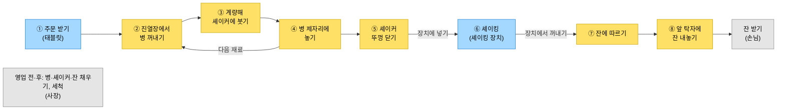

# D01 v2 문제 정의서 — 무인 칵테일 바 제조 로봇

D01 · 문제 정의서 · 작성 [조준혁](PM) · 검토 팀 전원 · 상태 검토 · v2.1

> 바를 **무인**으로 연다. 손님은 태블릿으로 주문하고, 로봇이 만든 잔을 바로 앞 탁자에서 받는다.
> 숫자는 모두 설명용 추정치다. 근거가 추정이면 '추정'이라고 적었다.
> 실제 제작 없이 **MuJoCo 시뮬레이션으로만** 만든다.

---

## 사용자(페르소나)

혼자 운영하는 동네 칵테일 바 사장. 지금은 직접 바텐더로 일하며 저녁 7시에서 새벽 2시까지만 연다. 사람을 더 쓰기 어려워 영업시간을 늘리지 못한다.
피크 3시간(금·토 밤 9시에서 자정) 동안 칵테일을 약 60잔 혼자 만들고(추정), 손님마다 "덜 달게", "도수 낮게" 같은 맞춤 요청을 받는다.
바를 무인으로 24시간 열고 싶어 한다.

함께 보는 사람: **손님** — 태블릿으로 주문(맞춤 포함)하고 앞 탁자에서 잔을 바로 받는다.

---

## 현재 작업 흐름(As-Is)

셰이크 칵테일(다이키리) 기준, 지금은 사장이 모두 손으로 한다:

① 주문 받기·셰이커 준비(사람) → ② 진열장에서 병 꺼내기 → ③ 계량해 셰이커에 붓기 → ④ 병 제자리에 놓기 → ⑤ 셰이커 뚜껑 닫기 → ⑥ 셰이킹 → ⑦ 잔에 따르기 → ⑧ 가니시·서빙(사람)

②\~④는 재료(병)마다 반복하고, ②\~⑦은 잔마다 반복한다.
빌드 칵테일(하이볼·진토닉)은 ③에서 잔에 바로 붓고, ⑤\~⑥ 대신 바 스푼으로 젓는다.

### 무인으로 바꾼 뒤 누가 맡나

- ① 주문 받기 → **태블릿**(손님이 직접, 맞춤 포함)
- ②\~⑤, ⑦ → **로봇팔**
- ⑥ 셰이킹 → **셰이킹 장치**(로봇팔은 셰이커를 장치에 넣고 뺀다)
- ⑧ 서빙 → **로봇팔**이 바로 앞 탁자의 픽업 칸에 잔을 내놓고, **손님**이 가져간다(가니시는 하지 않는다)
- 셰이커 준비 → **사장**이 영업 전에 깨끗한 셰이커·잔을 거치대에 채워 둔다

**로봇이 맡을 단계: ②\~⑤, ⑦, ⑧(앞 탁자에 내놓기)**

회색 칸 = 사람(손님·사장), 노란 칸 = 로봇팔이 맡을 범위, 파란 칸 = 장치(태블릿·셰이킹 장치)

**볼 곳:** ②\~④ 반복이 시간을 가장 많이 쓴다(잔마다 병 2\~3개). 계량을 눈대중으로 하면 잔마다 맛이 달라지고, ⑥ 셰이킹은 손목·어깨를 계속 쓴다. 이 모든 일을 사장 혼자 해야 해서 영업시간을 늘릴 수 없다.

### 로봇·장치가 맡을 단계와 사람에게 남는 단계

| 로봇팔 | 장치 | 사람 |
|---|---|---|
| ② 병 꺼내기 \~ ⑤ 뚜껑 닫기, 바 스푼으로 젓기, 셰이커를 장치에 넣고 빼기, ⑦ 거름망으로 잔에 따르기, ⑧ 앞 탁자에 잔 내놓기 | 태블릿: ① 주문·맞춤 입력 / 셰이킹 장치: ⑥ 셰이킹 | 손님: 주문, 잔 받기 / 사장: 영업 전·후 병·셰이커·잔 채우기와 세척 |
| 주문 데이터대로 계량 | 정해진 시간·세기로 흔들기 | 영업 중에는 바 안에 사람이 없다 |

---

## 불편 지표

| 지표 | 현재 값 | 근거 |
|---|---|---|
| 영업시간 | 하루 7시간(저녁 7시에서 새벽 2시) | 추정(혼자 운영, 인력 부족 가정) |
| 제조 잔 수 | 피크 3시간에 약 60잔 | 추정(바 이용 경험) |
| 병 꺼내고 넣기 | 하룻밤 약 150번(잔당 2\~3병) | 계산(잔 수 × 잔당 병 수) |
| 셰이킹 | 잔당 약 10\~15초 | 추정(바텐더 영상 관찰) |
| 한 잔 만드는 시간 | 약 2\~3분 | 추정(바텐더 영상 관찰) |
| 맛 편차 | 눈대중 계량 시 재료당 몇 ml씩 차이 | 추정(바 이용 경험) |
| 맞춤 요청 | 피크에 10잔 중 2\~3잔 | 추정(바 이용 경험) |

**로봇이 맡은 뒤 목표:** 바를 무인으로 24시간 연다. 손님은 태블릿으로 주문(맞춤 포함)하고 앞 탁자에서 바로 받는다. 사장은 영업 전·후 채우기와 세척만 한다. 같은 레시피는 같은 양으로, 맞춤 주문은 입력한 양대로 만든다.

> 위 표(현재 값)는 문제를 설명하는 숫자다. 우리가 잴 수 있는 것은 아래 '시뮬레이션에서 잴 것'이다.

---

## 로봇이어야 하는 이유

| 질문 | 답 |
|---|---|
| 물체를 옮기거나, 움직이거나, 닿는가 | 예, 병을 꺼내 붓고 셰이커와 잔을 장치·앞 탁자로 옮긴다 |
| 같은 동작을 반복하는가 | 예, 병마다(하룻밤 약 150번), 잔마다(약 60번) |
| 사람에게 불편·위험한가 | 사장 혼자라 영업시간을 늘릴 수 없다. 병 꺼내고 붓기를 하룻밤 150번 반복하고, 셰이킹으로 손목·어깨에 부담이 쌓인다 |
| 앱·센서·고정 장치로 안 되나 | 주문은 태블릿(앱)으로, 셰이킹은 고정 장치로 된다(그래서 둘은 장치에 맡긴다). 진열장의 여러 병을 꺼내 붓고 셰이커·잔을 옮기는 일은 고정 장치로 안 된다 |

---

## 시뮬레이션에서 잴 것

한 판 = 차터의 레시피 3개를 한 잔씩: 하이볼·진토닉(빌드), 다이키리(셰이크). 병 꺼내기는 약 7번이다. 그중 1잔은 맞춤 주문(예: 다이키리 시럽 절반).

- 3잔 한 판의 시간(주문 입력부터 마지막 잔이 앞 탁자에 놓일 때까지)
- 재료별 목표량과 실제로 부은 양의 차이(ml) — 기본 레시피와 맞춤 레시피 각각
- 병 낙하·충돌 수
- 셰이커를 장치에 넣고 빼기 실패 수, 흘림 수
- 같은 주문을 여러 판 연속으로 돌렸을 때 성공한 판 수(무인 24시간 운영 대신)

> 시뮬레이션 범위: MuJoCo에는 액체 시뮬레이션이 없으므로 따른 양은 "기울기 각도 × 시간" 공식으로 계산한다. 셰이킹 장치는 정해진 시간 동안 흔드는 단순 모델로 둔다. 태블릿은 화면 대신 주문 데이터(레시피·양)로 넣는다. 결제·성인 확인은 태블릿이 맡는다고 보고 범위에서 뺀다.

---

## 변경 이력

- v1: 문제 제안서(1일차 숙제)
- v2: 페르소나, As-Is 순서도, 불편 지표와 근거, 로봇이어야 하는 이유 검사표, 시뮬레이션에서 잴 것 추가 · 셰이킹을 별도 셰이킹 장치가 맡도록 변경 · 맞춤 주문 추가
- v2.1: 바텐더 보조 → **무인 운영**으로 방향 변경(태블릿 주문, 앞 탁자 픽업, 24시간 목표)
