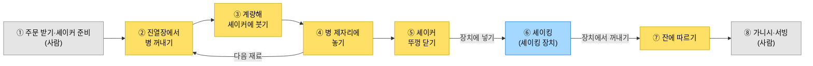

# D01 v2 문제 정의서 — 칵테일 바 제조 보조 로봇

D01 · 문제 정의서 · 작성 [조준혁](PM) · 검토 팀 전원 · 상태 검토 · v2

> 로봇은 바텐더를 대신하지 않고 **보조**한다. 바텐더는 손님을 맞고, 로봇은 제조를 맡는다.
> 숫자는 모두 설명용 추정치다. 근거가 추정이면 '추정'이라고 적었다.
> 실제 제작 없이 **MuJoCo 시뮬레이션으로만** 만든다.

---

## 사용자(페르소나)

혼자 운영하는 동네 칵테일 바 사장 겸 바텐더. 저녁 7시~새벽 2시에 일하고, 금·토 밤 9시~자정 피크 시간에는 혼자 주문을 받고 칵테일을 만든다.
피크 3시간 동안 칵테일을 약 60잔 만들고(추정), 손님마다 "덜 달게", "도수 낮게" 같은 맞춤 요청을 받는다.

---

## 현재 작업 흐름(As-Is)

셰이크 칵테일(다이키리) 기준:

① 주문 받기·셰이커 준비(사람) → ② 진열장에서 병 꺼내기 → ③ 계량해 셰이커에 붓기 → ④ 병 제자리에 놓기 → ⑤ 셰이커 뚜껑 닫기 → ⑥ 셰이킹 → ⑦ 잔에 따르기 → ⑧ 가니시·서빙(사람)

②~④는 재료(병)마다 반복하고, ②~⑦은 잔마다 반복한다.
빌드 칵테일(하이볼·진토닉)은 ③에서 잔에 바로 붓고, ⑤~⑥ 대신 바 스푼으로 젓는다.

**로봇이 맡을 단계: ②~⑤, ⑦** · ⑥ 셰이킹은 별도 **셰이킹 장치**가 맡고, 로봇팔은 셰이커를 장치에 넣고 뺀다.
바텐더가 ①에서 받은 주문(맞춤 요청 포함)을 태블릿에 입력하면 로봇이 그대로 만든다.

회색 칸 = 바텐더(사람), 노란 칸 = 로봇팔이 맡을 범위, 파란 칸 = 셰이킹 장치

**볼 곳:** ②~④ 반복이 시간을 가장 많이 쓴다(잔마다 병 2~3개). 계량을 눈대중으로 하면 잔마다 맛이 달라지고, ⑥ 셰이킹은 손목·어깨를 계속 쓴다. 맞춤 요청까지 들어오면 피크에 일일이 맞춰 주기 어렵다.

### 로봇·장치가 맡을 단계와 사람에게 남는 단계

| 로봇팔 | 셰이킹 장치 | 바텐더(사람) |
|---|---|---|
| ② 병 꺼내기 ~ ⑤ 뚜껑 닫기, 바 스푼으로 젓기, 셰이커를 장치에 넣고 빼기, ⑦ 거름망으로 잔에 따르기, 서빙 위치에 잔 내놓기 | ⑥ 셰이킹 | ① 주문 받기·태블릿 입력·셰이커 준비, ⑧ 가니시·서빙 |
| 레시피·맞춤 입력대로 계량 | 정해진 시간·세기로 흔들기 | 손님 응대, 맞춤 요청 듣기, 마지막 확인 |

---

## 불편 지표

| 지표 | 현재 값 | 근거 |
|---|---|---|
| 제조 잔 수 | 피크 3시간에 약 60잔 | 추정(바 이용 경험) |
| 병 꺼내고 넣기 | 하룻밤 약 150번(잔당 2~3병) | 계산(잔 수 × 잔당 병 수) |
| 셰이킹 | 잔당 약 10~15초 | 추정(바텐더 영상 관찰) |
| 한 잔 만드는 시간 | 약 2~3분 | 추정(바텐더 영상 관찰) |
| 맛 편차 | 눈대중 계량 시 재료당 몇 ml씩 차이 | 추정(바 이용 경험) |
| 맞춤 요청 | 피크에 10잔 중 2~3잔 | 추정(바 이용 경험) |

**로봇이 맡은 뒤 목표:** 바텐더는 주문 받기·손님 응대·가니시·서빙에 집중한다. 같은 레시피는 로봇팔이 같은 양으로 붓고 셰이킹 장치가 같은 시간으로 흔든다. 맞춤 요청은 태블릿에 입력한 양대로 붓는다.

> 위 표(현재 값)는 문제를 설명하는 숫자다. 우리가 잴 수 있는 것은 아래 '시뮬레이션에서 잴 것'이다.

---

## 로봇이어야 하는 이유

| 질문 | 답 |
|---|---|
| 물체를 옮기거나, 움직이거나, 닿는가 | 예, 병을 꺼내 붓고 셰이커를 장치와 잔 사이로 옮긴다 |
| 같은 동작을 반복하는가 | 예, 병마다(하룻밤 약 150번), 잔마다(약 60번) |
| 사람에게 불편·위험한가 | 병 꺼내고 붓기를 하룻밤 150번 반복하고, 셰이킹으로 손목·어깨에 부담이 쌓인다. 피크에 혼자 맞춤 요청까지 처리한다 |
| 앱·센서·고정 장치로 안 되나 | 셰이킹은 고정 장치로 된다(그래서 장치에 맡긴다). 진열장의 여러 병을 꺼내 붓고 셰이커를 장치·잔으로 옮기는 일은 고정 장치로 안 된다 |

---

## 시뮬레이션에서 잴 것

한 판 = 차터의 레시피 3개를 한 잔씩: 하이볼·진토닉(빌드), 다이키리(셰이크). 병 꺼내기는 약 7번이다. 그중 1잔은 맞춤 주문(예: 다이키리 시럽 절반).

- 3잔 한 판의 시간
- 재료별 목표량과 실제로 부은 양의 차이(ml) — 기본 레시피와 맞춤 레시피 각각
- 병 낙하·충돌 수
- 셰이커를 장치에 넣고 빼기 실패 수, 흘림 수

> 시뮬레이션 범위: MuJoCo에는 액체 시뮬레이션이 없으므로 따른 양은 "기울기 각도 × 시간" 공식으로 계산한다. 셰이킹 장치는 정해진 시간 동안 흔드는 단순 모델로 둔다. 태블릿 입력은 화면 대신 주문 데이터(레시피·양)로 넣는다.

---

## 변경 이력

- v1: 문제 제안서(1일차 숙제)
- v2: 페르소나, As-Is 순서도, 불편 지표와 근거, 로봇이어야 하는 이유 검사표, 시뮬레이션에서 잴 것 추가 · 셰이킹을 별도 셰이킹 장치가 맡도록 변경 · 로봇을 바텐더 보조로 정하고 맞춤 주문 추가
