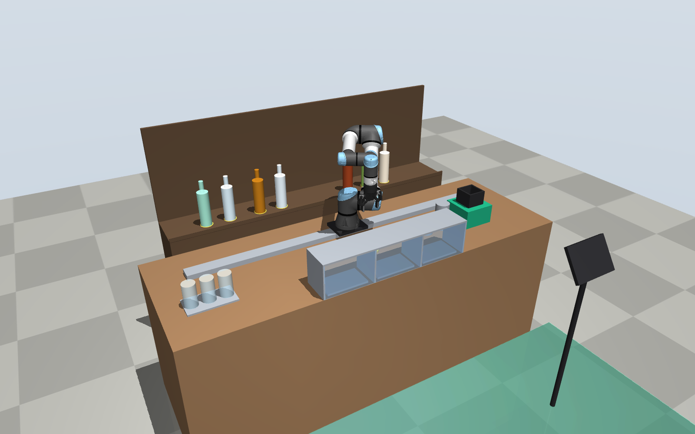
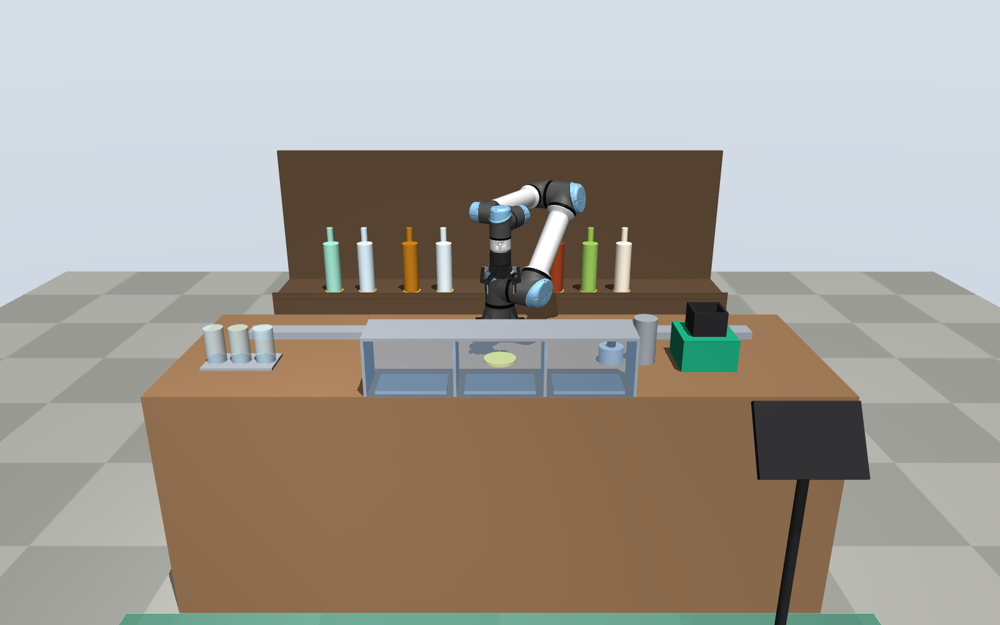
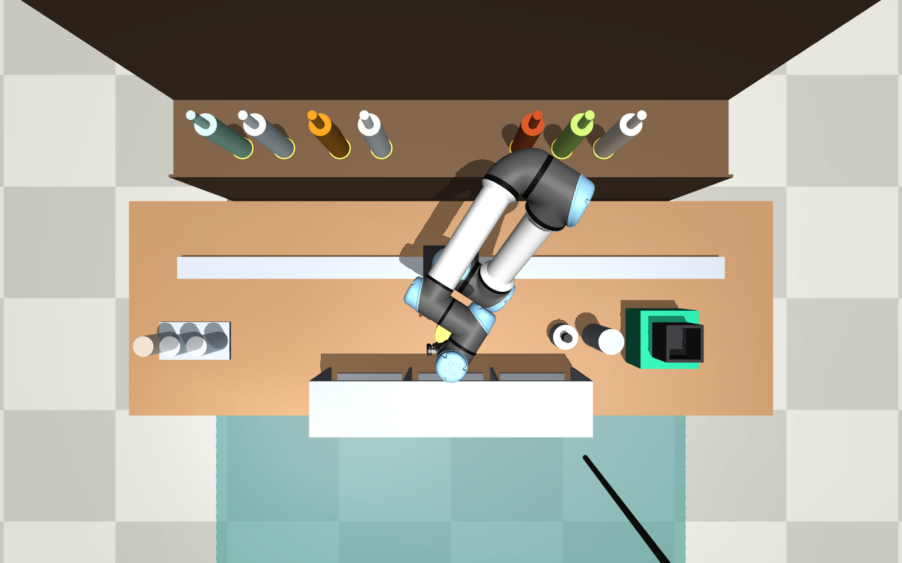

# D07 장면 구성표 — 칵테일 제조 로봇팔

D07 · 장면 구성표 · 작성 [조준혁](시뮬레이션) · 검토 [조준혁](PM) · 상태 작성 · v0.2 · 파일 scenes/cocktail_bar.xml

> 로봇팔은 **1대**로 정했다. 팔 2대(위·아래 협업)와 양팔 로봇은 범위 밖이다([D03](requirements.md)).
> 숫자는 설명용 가정값이다. 단위는 m · kg.

---

## 구성표

| 항목 | 내용 |
|---|---|
| 로봇 모델 | MuJoCo Menagerie UR5e(6관절) + Robotiq 2F-85 그리퍼. 리니어 레일(길이 2.0m, 이동 -0.8\~0.8m) 위에 올림 |
| 작업 물체 | 병 7개: 원기둥 지름 7cm · 높이 22cm + 목 지름 2.8cm · 높이 7cm, 각 1.2kg (진 · 토닉 · 위스키 · 탄산수 · 럼 · 라임 · 시럽) |
| | 잔 3개: 지름 7cm · 높이 13cm · 0.35kg / 셰이커 통: 지름 8.6cm · 높이 17cm · 0.3kg / 셰이커 뚜껑: 0.15kg |
| 고정물 | 작업대 2.4 × 0.8 × 0.9m, 진열장(한 단 · 한 줄, 선반 높이 0.95m, 앞 턱), 잔 거치대, 픽업 칸 3개(손님 쪽 문 닫힘), 저울 받침판 4개(붓는 자리 1, 픽업 칸 3) |
| 장치 | 셰이킹 장치: 셰이커를 담는 받침대가 위아래로 ±3cm 움직인다 |
| 센서 | 위 카메라 `top_cam`(RGB · 깊이), 손님 쪽 카메라 `front_cam`, 손가락 접촉(MuJoCo 접촉 목록에서 읽음), 관절 위치, **저울(무게 센서) 4개**: `scale_pour`, `scale_pickup_0` · `1` · `2` (touch 센서, N) |
| 무작위로 바꿀 값 | 병 위치 칸 안에서 ±1cm, 잔 위치 ±2cm, 셰이커 위치 ±1cm, 주문(기본 · 맞춤) |
| 플랫폼 결정 | 팔과 그리퍼는 검증된 Menagerie 모델을 그대로 쓰고, 나머지는 기본 도형으로 새로 만든다 |

병은 [D01](problem.md)의 원칙대로 **같은 모양 공병 하나로 통일**했다. 1.2kg은 차터의 "가장 무거운 병"(700ml 가득) 기준이다. 2F-85는 85mm까지 벌어지므로 지름 7cm 몸통을 잡을 수 있다.

---

## 좌표와 칸

x = 레일 방향(손님이 볼 때 왼쪽 -, 오른쪽 +), y = 앞뒤(손님 쪽 -, 진열장 쪽 +), z = 위.

| 이름 | 위치 (m) | 비고 |
|---|---|---|
| 레일 | y 0.15, z 0.93, x -0.8\~0.8 | 팔 바닥 높이 z 0.95 |
| 병 칸 | y 0.58, 선반 윗면 z 0.95 | x: 진 -0.75, 토닉 -0.6, 위스키 -0.4, 탄산수 -0.25, 럼 0.25, 라임 0.4, 시럽 0.55 |
| 잔 거치대 | (-0.95, -0.12, 0.91) | 잔 x -1.04, -0.95, -0.86 |
| 붓는 자리 저울 | (0, -0.1, 0.9) | 받침판 지름 12cm, 윗면 z 0.912. 레일 가운데 앞 |
| 셰이커 통 · 뚜껑 | 통 (0.53, -0.1), 뚜껑 (0.41, -0.1) | 셰이킹 장치 옆 |
| 셰이킹 장치 | (0.75, -0.1, 1.03) | 받침대 안쪽 10 × 10cm |
| 픽업 칸 | x -0.3, 0, 0.3 · y -0.31 | 칸 폭 30cm, 높이 20cm, 손님 쪽 문 y -0.4. 칸마다 저울 받침판 24 × 14cm(윗면 z 0.912) |
| 작업 영역(안전) | x -1.2\~1.2, y -0.38\~0.77, z 0.9\~1.8 | `work_zone` 사이트, D08 안전 개념 |

진열장 순서는 한 잔에 쓰는 병끼리 붙였다. 붓는 자리 왼쪽은 빌드(진토닉 · 하이볼), 오른쪽은 다이키리 재료다.

---

## 무게 센서(저울)

| 저울 | 하는 일 | 읽는 법 |
|---|---|---|
| `scale_pour`(붓는 자리) | 잔이나 셰이커 통을 올려놓고 붓는다. 무게가 늘어난 만큼이 부은 양이다 | 부은 양(ml) = 늘어난 무게(g) ÷ 재료 밀도(g/ml) |
| `scale_pickup_*`(픽업 칸 3개) | 잔이 칸에 놓였는지, 손님이 가져갔는지 안다 | 2N(약 200g)보다 크면 잔 있음 |

MuJoCo 센서 값은 받침판 위 접촉의 수직 힘(N)이다. 무게(g) = N ÷ 9.81 × 1000.

**시뮬레이션에서 액체 무게 흉내:** MuJoCo에는 액체가 없다. 그래서 병을 기울인 각도와 시간으로 따라진 양을 계산하고([D06 액체 흉내](architecture.md)), 그만큼 잔(또는 셰이커 통)의 질량 `model.body_mass`를 늘린다. 저울은 늘어난 무게를 진짜처럼 읽는다. 로봇 프로그램은 실제 바처럼 **저울 값만 보고** 붓기를 멈춘다.

---

## 확인 코드 기대값

병 7개, 병 질량 합 8.4kg. 저울은 비면 0N, 잔 하나를 올리면 3.43N(350g). MuJoCo 원기둥 `size`는 **반지름과 높이의 절반**이다: 몸통 `size="0.035 0.11"`(지름 7cm · 높이 22cm).

```python
m = mujoco.MjModel.from_xml_path("scenes/cocktail_bar.xml")
병 = [m.body(i).name for i in range(m.nbody)
     if m.body(i).name.startswith("bottle_")]
print(len(병), round(sum(m.body(n).mass[0] for n in 병), 3))
```

출력:

```
7 8.4
```

같은 확인을 `tests/test_scene.py`로도 돌린다(병 개수 · 질량, 잔 · 셰이커, 액추에이터 · 카메라 · 저울 센서, 저울 무게, home에서 2초 안정). `uv run pytest -q tests` → 장면 테스트 5개 통과.

---

## 장면 v0 결과







| 그림에서 볼 곳 | 내용 |
|---|---|
| 로봇 | UR5e + 2F-85, 레일 가운데 home 자세(그리퍼는 붓는 자리 위) |
| 작업 물체 | 병 7개(진열장), 잔 3개(왼쪽 거치대), 셰이커 통 · 뚜껑(오른쪽) |
| 고정물 · 장치 | 작업대, 진열장, 픽업 칸 3개(손님 쪽 유리문, 바닥에 저울), 붓는 자리 저울(노란 받침판), 셰이킹 장치(초록) |

---

## 눈으로 · 숫자로 더 확인한 것

- **물체가 튀지 않는다:** home 자세에서 3초 돌려도 병은 0.04mm, 잔과 뚜껑은 1.1mm만 움직였다(1mm 위에 놓아 내려앉은 것). 시작할 때 1mm 넘게 겹친 물체는 없다.
- **팔이 닿는다:** 아래 목표에 대해 역기구학(IK)을 풀어 손끝 오차 2mm 안으로 다 풀렸다. 충돌은 아직 보지 않았다.
  - 병 7개(옆에서 잡기, 높이 z 1.08), 잔 3개(위에서), 붓는 자리, 픽업 칸 3개(칸 안에 놓기), 셰이커 통 · 뚜껑(위에서), 셰이킹 장치 위
- **저울이 맞게 읽는다:** 붓는 자리에 잔을 올리면 350.1g, 위스키 45ml만큼(42.3g) 질량을 늘리면 392.1g으로 계산값과 0.2g 차이다. 빈 픽업 칸 저울은 0이다.
- **알려진 문제:** 팔은 위치 제어만 해서 중력 때문에 손끝이 약 6mm 처진다. [D03](requirements.md) Subsystem의 "손끝 오차 10mm 이하"에 영향을 주므로 개발 단계에서 중력 보상을 넣는다.

---

## 장면 열기

```
uv run python -m mujoco.viewer --mjcf=scenes/cocktail_bar.xml   # 맥은 mjpython
```

처음 열면 팔이 0 자세(옆으로 쭉 편 상태)다. 왼쪽 Simulation 패널에서 **Key 0(home)** 을 고르고 **Load key** 를 누르면 home 자세가 된다.

---

## 에이전트에게 준 요청문

```
[맥락] scenes/menagerie/ 에 UR5e와 2F-85 모델이 있어. docs/scene.md 를 먼저 읽어.
[할 일] docs/scene.md 구성표와 좌표표대로 scenes/cocktail_bar.xml 을 만들어.
[조건] 병 이름 bottle_<재료>, 잔 이름 cup_0~cup_2, 단위는 m·kg. 팔은 레일 위 1대.
[완료 기준] 뷰어로 열리고, 확인 코드가 '7 8.4' 를 출력. tests/test_scene.py 통과.
[보고] 바꾼 파일과 확인 코드 출력, 스크린샷을 알려 줘.
```

---

## Menagerie 모델 출처

`scenes/menagerie/` — [google-deepmind/mujoco_menagerie](https://github.com/google-deepmind/mujoco_menagerie) 커밋 `eea4c74`(2026-11-23). 라이선스 파일을 같이 넣었다. 바꾼 점은 [scenes/menagerie/README.md](../scenes/menagerie/README.md)에 적었다.
